**Penetration Testing · Scripting · Pwning**

*10+ years in security*  
*Tinkering when I can ☕, pwning at work!*

Hope to add more here as and when...

## Cyhoeddus / Public

[**Cyhoeddus**](https://github.com/demetae/cyhoeddus) — a public collection of things I've found useful.
